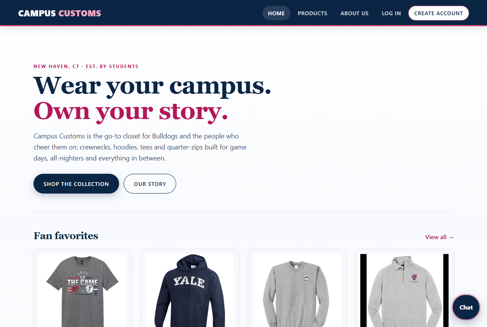
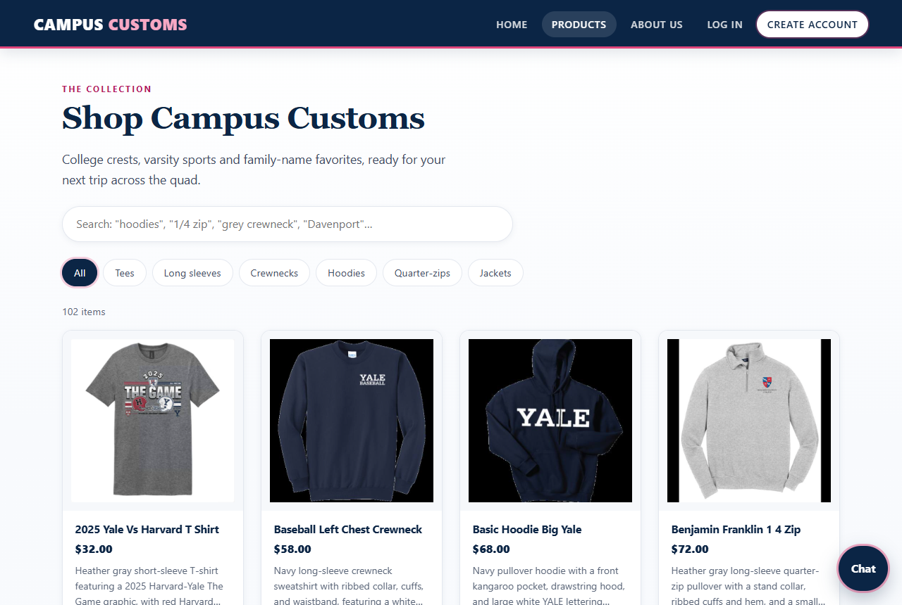
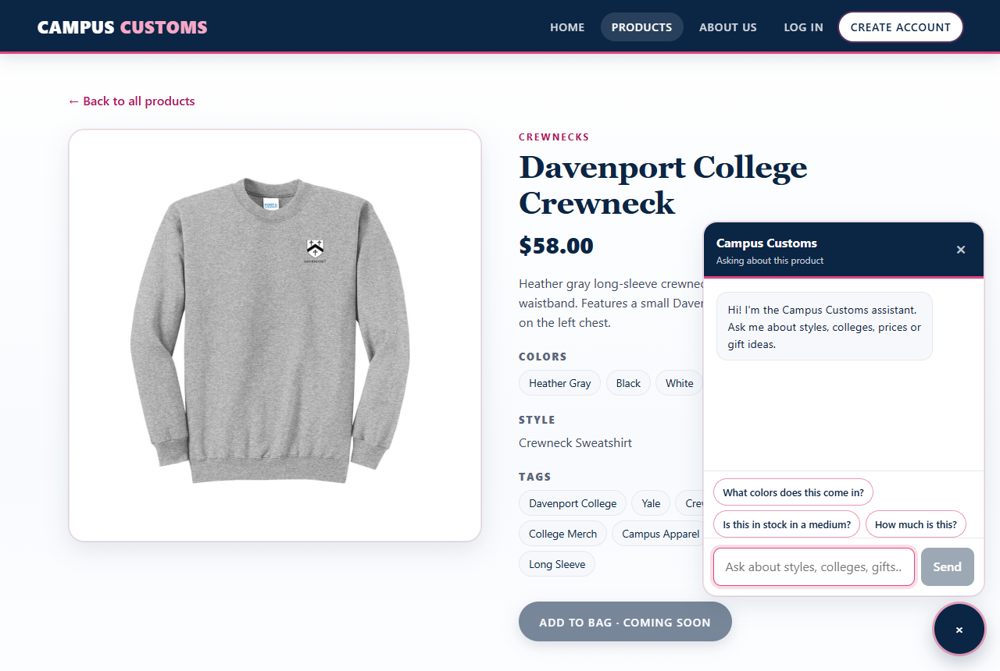
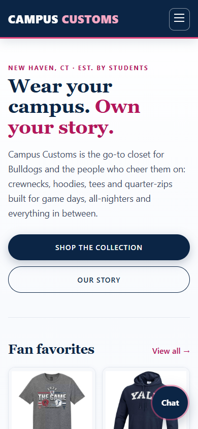
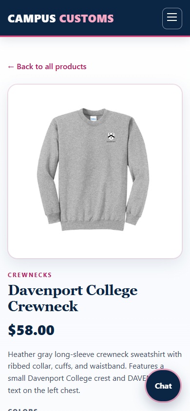
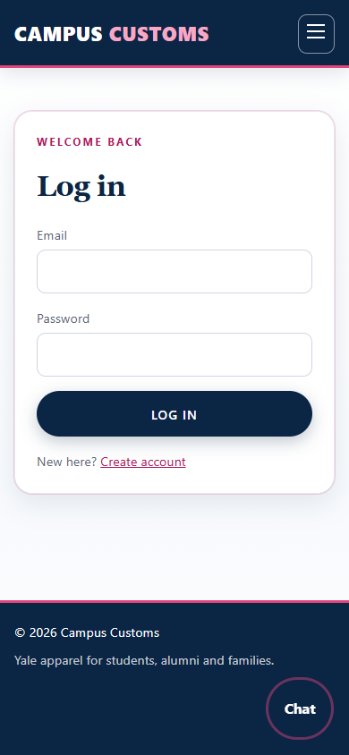
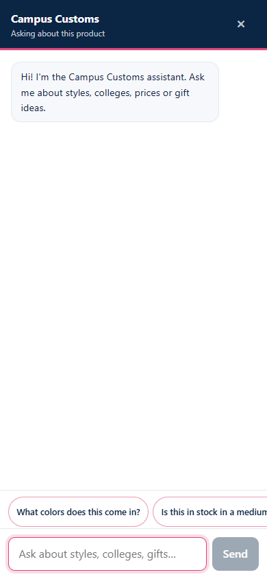

# Campus Customs: Premium Storefront Design

A cohesive navy and white design with pink accents across Home, Products, product details, sign-in
forms and the chat. All functionality is unchanged: every existing test still passes. Screenshots from
the design review are in [`output/design/`](design/).

## What changed and why it helps customers

| Area | Change | Customer benefit |
| --- | --- | --- |
| **Color** | Deep navy `#0b2545` and white base, Yale blue for hovers, **pink accents** (`#e0457b` for rules, rings and glows; darker `#b3165a` for pink text). The header and footer have a thin pink rule. | Feels premium and on-brand. Pink draws the eye only to what matters (headlines, links, focus). |
| **Typography & hierarchy** | Serif display font (Georgia) for page titles and section headings; clean sans for body text; uppercase pink eyebrows; 1.65 line height for paragraphs; larger detail-page price. | Clear "what is this page / what matters" scanning, and a boutique feel. |
| **Spacing** | More generous section padding and card gaps on desktop, tighter but even spacing on phones. | Less cluttered, easier to scan. |
| **Product cards** | 14px rounded cards, light image well, soft shadow. On hover they lift 4px with a soft pink glow border and the image zooms 3%. Cards fade up gently on load. | Products feel tactile and clickable; the grid reads as a curated collection. |
| **Detail page** | Glowing image frame, serif title, bold navy price, pill-style tags. | Focus on the product and its price. |
| **Buttons** | Pill buttons: navy primary with a pink ring on hover, outlined secondary, pink-tinted hover. | Obvious primary action, consistent everywhere. |
| **Forms** | Rounded inputs, pink focus glow, red error ring and message under each field, glowing card. | It's clear which field you're in and what to fix. |
| **Chat** | Rounded panel with a soft glow and a quick "pop" entrance, navy header with a pink rule, navy launcher with a pink ring, pill suggestions, pink typing dots. | The assistant feels like part of the store, not a bolt-on widget. |
| **Loading** | **Skeleton cards** (shimmering placeholders) replace "Loading…" text on Home and Products. | The page feels instant and doesn't jump when products arrive. |
| **Empty & error states** | White card with a pink-ringed icon, serif heading and a helpful next step (search suggestions, "Browse products"). | Dead ends become next steps. |
| **Motion** | Short (0.2–0.4s) eased transitions only: card rise, hover lift, chat pop, shimmer. **All animation is switched off for "reduce motion" users.** | Polished but never distracting. |
| **Accessibility** | 3px pink keyboard focus ring (visible on white and navy). Contrast meets WCAG AA (table below). Responsive layouts from 375px phones to desktop. | Usable by keyboard, low-vision and mobile shoppers. |

Code: a "Premium storefront design" layer at the end of `frontend/src/index.css`, plus
`frontend/src/components/ProductGridSkeleton.tsx` (used on Home and Products).

## Review (desktop 1280px and mobile 390px, running app)

Script: `output/design/review_design.py` (run from `hw4/` with both servers up). It also produced the
screenshots below.

| Check | Result |
| --- | --- |
| Contrast: body text `#14213d` / white | 15.97:1 ✅ (AA ≥ 4.5) |
| Contrast: muted text `#5b6678` / white, and on `#f6f8fb` panels | 5.81:1 and 5.46:1 ✅ |
| Contrast: pink text `#b3165a` / white | 6.61:1 ✅ |
| Contrast: white / navy, brand pink `#f6a8c4` / navy | 15.39:1, 8.29:1 ✅ |
| Contrast: pink focus ring on white / on navy | 3.96:1, 3.89:1 ✅ (non-text ≥ 3) |
| Keyboard focus | Tabbing through the header, nav, chips and cards shows a solid 3px pink ring on each; the search box uses a pink border and glow ✅ |
| Responsiveness | Home, Products, a product page and Log in: no sideways scrolling at 1280px or 390px ✅ |
| Images | All visible product images load on every reviewed page, desktop and mobile ✅ |
| Non-disruptive motion | With `prefers-reduced-motion: reduce`, card animations are `none` ✅ |

**Issue found and fixed:** the category chips used `transition: all`, so their keyboard focus ring
briefly animated from white or gray to pink. The transition is now limited to border, color, background
and shadow, and the ring is pink immediately.

| Desktop home | Desktop products | Desktop detail + chat |
| --- | --- | --- |
|  |  |  |

| Mobile home | Mobile detail | Mobile log in | Mobile chat |
| --- | --- | --- | --- |
|  |  |  |  |
