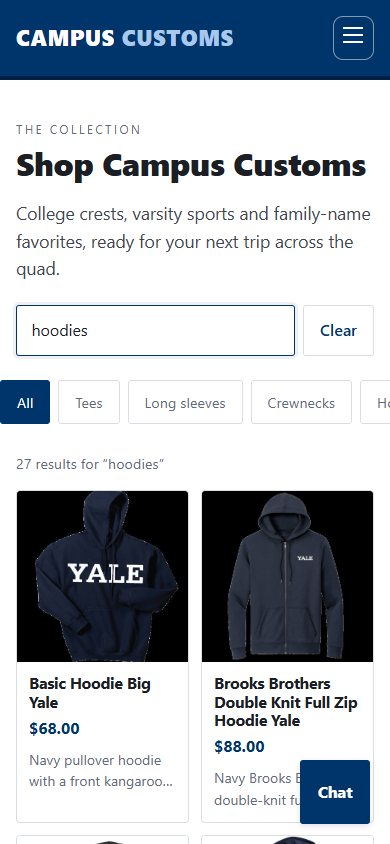
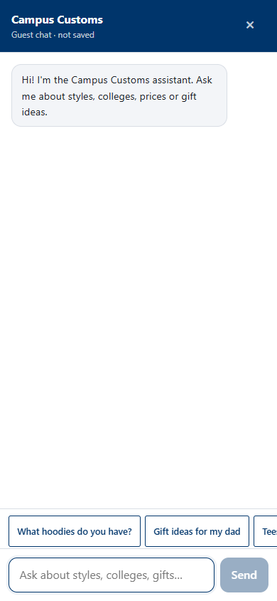
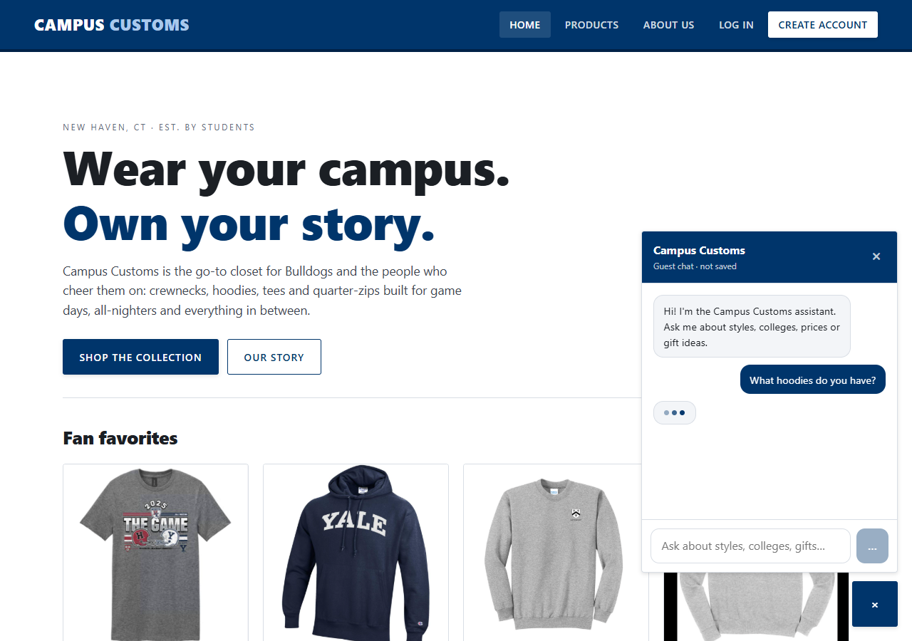
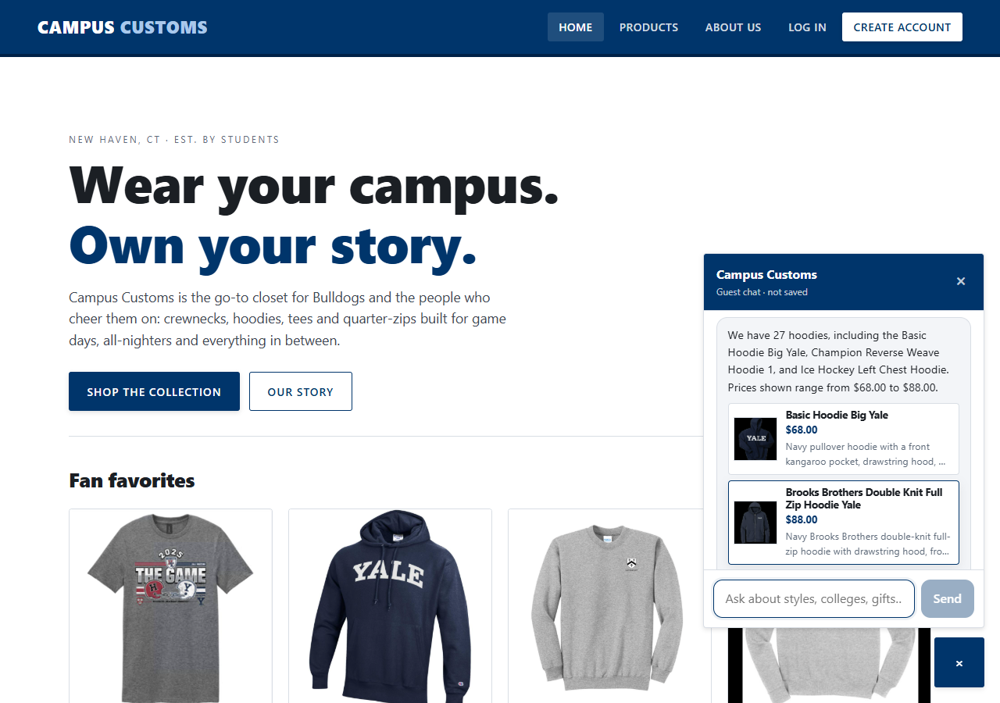
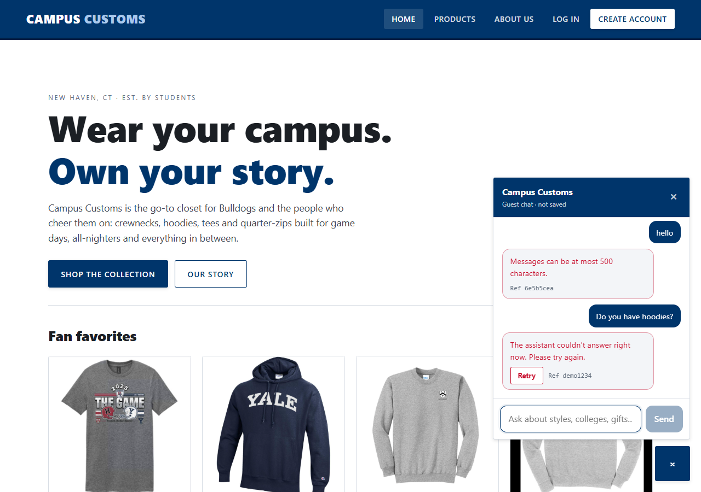
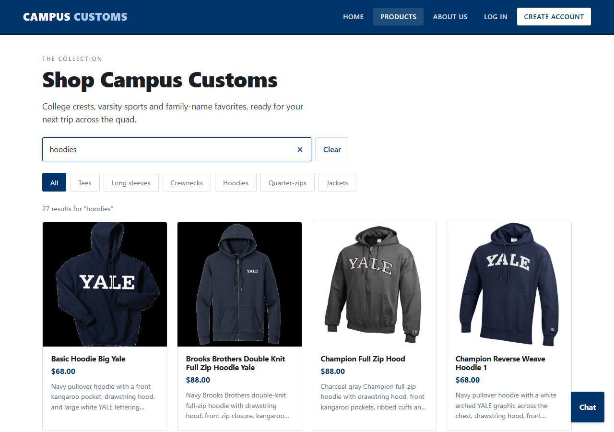
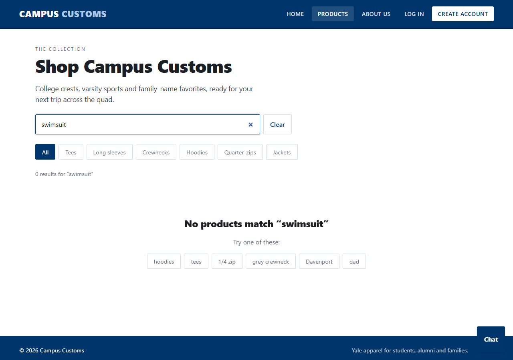
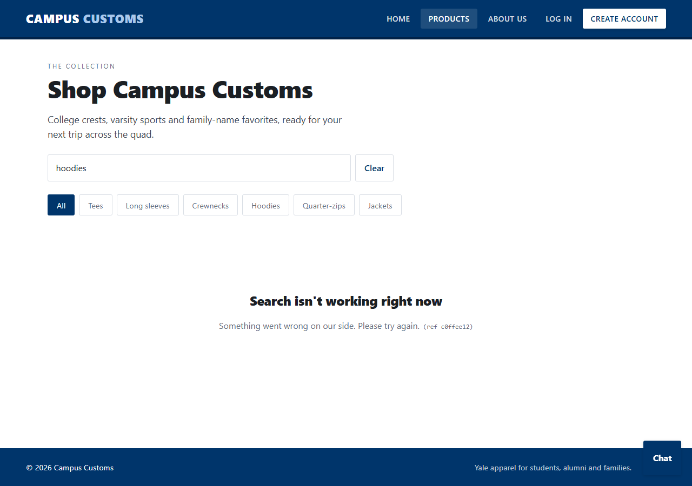

# Campus Customs: Usability Improvements

Exactly four improvements: two frontend and two backend. Each is visible in the running app at
<http://localhost:5173> (backend <http://localhost:8000>). For each one, this file covers what it does,
why it helps, and how to verify it, by hand and with automated checks. Screenshots of the running app are
in [`output/usability/`](usability/).

| # | Side | Improvement | Main files |
| --- | --- | --- | --- |
| 1 | Frontend | Responsive mobile layout | `frontend/src/index.css` (mobile section), `index.html` |
| 2 | Frontend | Chat suggestions, loading, errors and accessibility | `frontend/src/components/ChatWidget.tsx`, `index.css` |
| 3 | Backend | Normalized, deduplicated catalogue search | `backend/search.py`, `tools.py`, `main.py` (`GET /api/products/search`), `ProductsPage.tsx` |
| 4 | Backend | Concise, safe error handling | `backend/app/errors.py`, `main.py`, `frontend/src/api.ts` |

---

## 1. Responsive mobile layout (frontend)

**What it does** (phones, ≤ 600px wide):
- **Chat becomes a full-screen sheet.** It covers the whole screen (`100dvh`, respects the iPhone home
  bar) instead of a small floating box. The floating button hides while it's open; the header × closes it.
- **Category chips form one swipeable row** instead of wrapping onto several lines and pushing products
  down.
- **44px minimum touch targets** for nav links, chips, buttons, Send, Close, Retry and suggestions
  (Apple and WCAG guidance).
- **16px text in every input**, so iPhone Safari doesn't zoom the page when a field is tapped.
- The hero buttons stack full-width, the detail-page button is full-width, and the footer leaves room
  for the chat button.

**Why it helps:** most shoppers browse on phones. Before, the chat was a 360px box squeezed onto a
375px screen, chips took up several lines, and small buttons were easy to miss. Now it's thumb-friendly
and nothing scrolls sideways.

**How to verify:**
1. Open <http://localhost:5173/products> and press F12 → device toolbar → iPhone 12/13 (390px).
2. Swipe the chip row sideways; it's a single line. The page itself doesn't scroll sideways.
3. Tap **Chat**: it fills the screen; tap × to close.
4. Tap the search box: the page doesn't zoom.

| Phone: products + search | Phone: full-screen chat with suggestions |
| --- | --- |
|  |  |

Automated: `e2e/test_usability_ui.py` (`test_mobile_*`, 4 tests) checks the chat panel is exactly
0,0,375 × ≥ 800px, the chips sit on one row and scroll, targets are ≥ 44px, inputs are 16px, and hero
buttons stack. The existing `test_mobile_layout_and_menu` confirms no sideways scrolling on 6 pages.

---

## 2. Chat suggestions, loading, errors and accessibility (frontend)

**What it does:**

| Area | Behaviour |
| --- | --- |
| **Suggestions** | A new chat shows one-tap questions: "What hoodies do you have?", "Gift ideas for my dad", "Tees under $40". On a product page they become questions about *this* product: "What colors does this come in?", "Is this in stock in a medium?", "How much is this?" (sent with the page's product, see harness.md Part E). They hide while typing or waiting. |
| **Loading** | A typing indicator (with screen-reader text "Assistant is typing…"), Send shows "…" and is disabled, and signed-in users see "Loading your conversation…" while their history loads. |
| **Errors** | Error bubbles show the server's short message plus a **Retry** button (re-asks without duplicating the question) and a **Ref** id matching the server log. Retry is hidden when retrying can't help (e.g. a too-long message). **Offline**: "You're offline. Check your connection, then tap Retry." and nothing is sent. If history can't load, that's shown instead of a blank chat. |
| **Accessibility** | The conversation is a `role="log"` live region, so screen readers announce new replies. Bubbles are prefixed "You:" / "Assistant:" for screen readers. The launcher has `aria-controls`/`aria-haspopup`. Focus moves into the box on open and **returns to the launcher** on close or Escape. A character counter ("430 / 500") appears near the limit and is linked with `aria-describedby`. Clear **keyboard focus outlines** appear everywhere (3px Yale blue, keyboard only). `prefers-reduced-motion` turns off animations. |

**Why it helps:** shoppers don't have to guess what to ask, they can see the assistant is working, a
failure is one tap to fix instead of retyping, and keyboard and screen-reader users can use the chat
fully.

**How to verify:**
1. Open the chat on the home page and tap **What hoodies do you have?** You'll see the typing dots, then
   a reply with product cards.
2. Open a product page, then the chat: the suggestions are about that product.
3. F12 → Network → set "Offline", send a message: the offline bubble appears. Go back online and tap
   **Retry**.
4. Keyboard only: Tab to **Chat**, press Enter; the box is focused. Type 400+ characters to see the
   counter. Press Escape; focus is back on **Chat**.

| Loading | Success (real reply, 12 cards) | Error with Retry + Ref |
| --- | --- | --- |
|  |  |  |

Automated: `e2e/test_usability_ui.py` covers suggestions (general and product page), loading states
(typing and history), error + Retry + Ref, offline, a **real** backend 422 shown with its request id,
accessibility roles and focus, and visible keyboard focus.

---

## 3. Normalized, deduplicated catalogue search (backend)

**What it does:** one search engine (`backend/search.py`) is used by the **storefront search box** (new
`GET /api/products/search`) and by both chat search tools, so the shop and the assistant always agree.

- **Normalization:** queries and products go through the same steps: lower-case, accents removed
  ("Café" → cafe), punctuation and possessives dropped ("Dad's" → dad), plurals made singular, and
  synonyms and odd spellings merged:

  | Typed | Becomes | Example in the catalogue |
  | --- | --- | --- |
  | hoodies, HOODY, hooded | hoodie | 27 hoodies |
  | tees, T-Shirts, t shirt, shirts | tshirt | 25 tees ("Benjamin Franklin T Shirt") |
  | 1/4 zip, quarter zips, qtr-zip | quarterzip | 11 quarter-zips (named "… 1 4 Zip" in the data) |
  | crew neck, crewnecks | crewneck | also finds the data's typo "Yale Sports **Creqneck** Field Hockey" |
  | grey | gray | "heather gray" products |
  | mum, mother / father | mom / dad | family-name items |

  A category word in the query becomes a category filter ("navy hoodies" = hoodies that mention navy).
- **Deduplication:** repeated words count once ("hoodie hoodies HOODIE" = "hoodie"), each product
  appears at most once, a category given twice isn't applied twice, and results from several searches
  merge by id (`merge_unique`).
- **Closest matches:** if no product matches *every* word ("gift for my dad"), the products matching the
  most words are shown and labelled "no exact match, showing closest results". A single unknown word
  ("swimsuit") returns nothing rather than guessing.
- **In the storefront:** a search box on **Products** with a live result count ("27 results for
  'hoodies'"), a shareable URL (`?q=`), Clear, combining with category chips, and an empty state with
  example searches.

**Why it helps:** shoppers type "tees", "1/4 zip" or "grey crewneck", not the catalogue's exact wording
("T Shirt", "1 4 Zip", "heather gray"). Before, those found nothing, or different results in the chat
and the shop. Now every common spelling gets the same, complete, duplicate-free results.

**How to verify:**
1. On <http://localhost:5173/products>, search **hoodies**, **HOODY** and **hoodie hoodies HOODIE**:
   each says "27 results".
2. **tees** = **T-Shirts** = 25. **1/4 zip** = **quarter zips** = 11.
3. **field hockey crewneck** finds the "Creqneck" item. **gift for my dad** shows the closest-results
   note. **swimsuit** shows the empty state; tap a suggestion.
4. API: <http://localhost:8000/api/products/search?q=Hoodies!!> → `"total": 27`.

| Search results | Empty state |
| --- | --- |
|  |  |

Automated: `backend/tests/test_improvements.py` (search half: spelling variants for all 6 categories,
grey/gray, typos, normalization steps, de-duplication, `merge_unique`, closest matches, endpoint, and
"endpoint = chat tool") and `e2e/test_usability_ui.py` (search box variants, no duplicate cards, typo,
closest-match note, empty state, URL, Clear, chip + search together).

---

## 4. Concise, safe error handling (backend)

**What it does** (`backend/app/errors.py`, applied to every endpoint):
- **One error shape everywhere:** `{"detail": "<short message>", "code": "<machine code>", "request_id": "<8 hex>"}`
  (validation errors: `detail` is a list of `{field, msg}`). Codes include `not_found`,
  `product_not_found`, `validation_error`, `unauthorized`, `too_large`, `assistant_unavailable`,
  `assistant_error`, `assistant_timeout` and `internal_error`.
- **Request ids:** every response, success or error, carries `X-Request-ID`, and server log lines include
  the same id. The UI shows it as "Ref …", so a shopper's report can be matched to the log.
- **Nothing internal leaks:** unexpected crashes return "Something went wrong on our side. Please try
  again." The traceback goes only to the server log. No exception text, SQL, file paths or submitted
  values (e.g. passwords) are ever returned. Crash responses still carry CORS headers, so the browser
  can show the message instead of a vague network error.
- **Plain-English validation:** "Enter a valid email address.", "Use at least 8 characters.", "This
  field is required.", "This field can't be blank.", "The request body isn't valid JSON.", one message
  per field, instead of pydantic's technical text.
- **Size limit:** request bodies over 16 KB get `413 "That request is too large."` before parsing.

**Why it helps:** shoppers see short, useful messages instead of technical errors or blank screens.
Support can find any error in the log from the "Ref". Attackers learn nothing about the internals.

**How to verify:**
1. <http://localhost:8000/api/nope> → `{"detail":"Not found.","code":"not_found","request_id":"…"}`.
2. <http://localhost:8000/api/products/yale-unicorn-onesie> → `product_not_found`. In the shop,
   <http://localhost:5173/products/yale-unicorn-onesie> shows "We couldn't find that item".
3. Create account with a bad email or a 5-character password: plain-English messages under the fields.
4. F12 → Network on any request: response header `X-Request-ID`.

| Chat: real 422 + simulated 502 with Ref | Storefront search error with ref |
| --- | --- |
|  |  |

Automated: `backend/tests/test_improvements.py` (errors half: 404/405 shape, specific codes, request id
on success too, plain-English validation, one message per field, bad query parameters, invalid JSON,
413, a crash with secret-looking text that stays hidden and keeps CORS, chat error codes) and
`e2e/test_usability_ui.py` (search error panel with ref, unknown product page, a real backend 422 shown
with its request id).

---

## Review against the running app

`output/usability/review_running_app.py` drives the **running** app (both servers up, real data, real
model) through every state above and saved the screenshots in this file:

```powershell
# from hw4/, with the backend (:8000) and frontend (:5173) running
.\backend\.venv\Scripts\python.exe output\usability\review_running_app.py
```

Result: **14/14 checks passed.**

| Check | Result |
| --- | --- |
| 1. Every page fits the phone width | 6 pages, no sideways scrolling at 390px |
| 1. Category chips are one swipeable row | 7 chips in one swipeable row |
| 1. 44px touch targets, 16px inputs | min height 44px, search input 16px |
| 1. Chat opens full-screen | full-screen sheet; Send/Close ≥ 44px |
| 2. Suggestions (general and product page) | 3 general, 3 product questions |
| 2. Loading indicator then successful reply (live) | typing indicator with screen-reader text, then real reply + 12 cards ("Showing 12 of 27") |
| 2. Empty result shows reply only, no cards (live) | "I couldn't find any swimsuits in the current catalogue. We do have hoodies…" |
| 2. Concise error with Ref and Retry | real 422 shown as a plain message with its Ref; 502 shows Retry + Ref |
| 2. Offline state | offline message, nothing sent |
| 2. Accessibility | `role=log`, focus moves in and back, Escape closes, 450 / 500 counter |
| 3. Spelling variants agree, no duplicates | hoodies = HOODY = "hoodie hoodies HOODIE" = 27; tees = T-Shirts = 25; 1/4 zip = quarter zips = 11 |
| 3. Typo, closest-match and empty states | "Yale Sports Creqneck Field Hockey" found; closest-results note; empty state with suggestions |
| 4. One concise error shape with request id | 404 `not_found`; 404 `product_not_found`; 422 `validation_error`; `X-Request-ID` on success too |
| 4. Errors visible in the storefront | search error panel with ref; unknown product page |

**Problems found by the review and fixed:**
1. **Search and category chip overwrote each other.** Clicking a chip within 250ms of typing a search
   dropped the chip (`?q=navy` instead of `?q=navy&type=crewneck`), because the delayed search update
   used a stale copy of the URL. `ProductsPage.update()` now starts from the live URL. A browser test
   reproduces the timing and passes.
2. **Two clear buttons on mobile search.** The browser's built-in "×" appeared next to the labelled
   **Clear**. The built-in one is now hidden (screenshot 1).
3. **Chat lost its accessible name.** Switching the dialog to `aria-labelledby` renamed it from
   "Campus Customs chat" to "Campus Customs". It's back to the clearer `aria-label`. This was caught
   by the existing browser tests.

## Test totals

```powershell
cd backend; .\.venv\Scripts\python.exe -m pytest; cd ..          # 192 passed (38 in test_improvements.py)
.\backend\.venv\Scripts\python.exe -m pytest e2e                 # 70 passed (19 in test_usability_ui.py)
```
